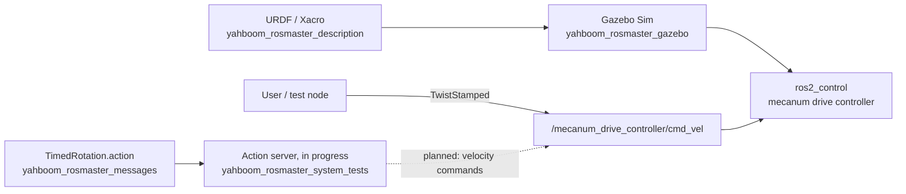

<div align="center">

# Yahboom Rosmaster X3: ROS 2 Simulation & Mecanum Control

**Robot description, Gazebo bringup, mecanum-drive velocity control and a custom `TimedRotation` action interface for the Yahboom Rosmaster X3, built on ROS 2 Jazzy.**


<!-- DEMO VIDEO: replace with docs/media/demo.gif or a YouTube thumbnail link -->
> 🎥 **DEMO VIDEO PLACEHOLDER**: robot strafing in Gazebo from a `cmd_vel` command. Save as `docs/media/demo.gif`.

</div>

---

## Table of Contents
1. [Overview](#overview)
2. [Demo](#demo)
3. [Features](#features)
4. [System Architecture](#system-architecture)
5. [Repository Structure](#repository-structure)
6. [Getting Started](#getting-started)
7. [Usage](#usage)
8. [Custom TimedRotation Action](#custom-timedrotation-action)
9. [Results](#results)
10. [Development Status](#development-status)
11. [Troubleshooting](#troubleshooting)
12. [Roadmap](#roadmap)
13. [Acknowledgements & Licensing](#acknowledgements--licensing)
14. [Author](#author)

---

## Overview

This repository is a ROS 2 workspace for the **Yahboom Rosmaster X3**, a mecanum-wheel mobile robot. It covers:

- the robot's **URDF/Xacro** description and RViz 2 visualization,
- a **Gazebo** simulation bringup script,
- a **mecanum-drive** controller driven by `geometry_msgs/msg/TwistStamped` commands,
- a custom **`TimedRotation.action`** interface with a C++ action server (`rclcpp_action`) under development.

> **Scope:** simulation and software integration. Physical-robot validation is **not claimed**. The `TimedRotation` action server is **in progress**.

---

## Demo

| Gazebo simulation | RViz 2 |
|:---:|:---:|
|  |  |
| *ADD SCREENSHOT: robot in Gazebo* | *ADD SCREENSHOT: model in RViz 2* |

| Lateral (strafe) motion | Rotation |
|:---:|:---:|
|  |  |
| *ADD GIF: `linear.y` command* | *ADD GIF: `angular.z` command or the TimedRotation goal once it works* |

📹 **Full walkthrough video:** `ADD LINK`

---

## Features

- ✅ Robot description in **URDF/Xacro** with RViz 2 visualization
- ✅ **Gazebo** bringup script (`rosmaster_x3_gazebo.sh`)
- ✅ Mecanum-drive command interface at `/mecanum_drive_controller/cmd_vel` (`TwistStamped`)
- ✅ Custom **`TimedRotation.action`** interface in its own package
- 🟡 C++ **action server** (`rclcpp_action`): in progress

---

## System Architecture



<!-- Replace the dotted "planned" link once the action server publishes to cmd_vel. -->

---

## Repository Structure

| Package / directory | Purpose |
|---|---|
| `yahboom_rosmaster_description` | Robot description and visualization resources |
| `yahboom_rosmaster_bringup` | Launch and bringup scripts (includes `rosmaster_x3_gazebo.sh`) |
| `yahboom_rosmaster_gazebo` | Gazebo-related resources |
| `yahboom_rosmaster_messages` | Custom action/message interfaces (`TimedRotation.action`) |
| `yahboom_rosmaster_system_tests` | System tests and action-server development |
| `yahboom_rosmaster` | Robot-specific package/resources |
| `macanum_drive_controller` | Drive-controller package (directory name keeps the original spelling) |

> Run `colcon list` after cloning to confirm the packages in your checkout.

---

## Getting Started

### Requirements
- Ubuntu 24.04 with **ROS 2 Jazzy**
- `colcon`, `rosdep`, RViz 2 and Gazebo packages needed by the launch files

### Build

```bash
mkdir -p ~/ros2_ws/src && cd ~/ros2_ws/src
git clone https://github.com/Yashs2024/yahboom-rosmaster-ros2.git yahboom_rosmaster

cd ~/ros2_ws
source /opt/ros/jazzy/setup.bash
rosdep install --from-paths src --ignore-src -r -y
colcon build --symlink-install
source install/setup.bash
```

---

## Usage

### 1. Start the Gazebo workflow

```bash
cd ~/ros2_ws
source /opt/ros/jazzy/setup.bash
source install/setup.bash
bash src/yahboom_rosmaster/yahboom_rosmaster_bringup/scripts/rosmaster_x3_gazebo.sh
```

If the path differs in your checkout: `find ~/ros2_ws/src -name 'rosmaster_x3_gazebo.sh'`

### 2. Drive the robot (mecanum velocity commands)

The controller subscribes to `/mecanum_drive_controller/cmd_vel` (`geometry_msgs/msg/TwistStamped`).

| Field | Typical meaning on a mecanum base |
|---|---|
| `twist.linear.x` | forward / backward |
| `twist.linear.y` | lateral (strafe) |
| `twist.angular.z` | yaw rate |

Confirm the sign conventions in your controller configuration first.

```bash
ros2 topic info /mecanum_drive_controller/cmd_vel

# small lateral test (stop with Ctrl+C)
ros2 topic pub --rate 10 /mecanum_drive_controller/cmd_vel geometry_msgs/msg/TwistStamped \
"{header: {stamp: {sec: 0, nanosec: 0}, frame_id: ''}, twist: {linear: {x: 0.0, y: 0.1, z: 0.0}, angular: {x: 0.0, y: 0.0, z: 0.0}}}"
```

Use conservative speeds.

---

## Custom TimedRotation Action

- **Definition:** `yahboom_rosmaster_messages/action/TimedRotation.action`
- **Server (in development):** `yahboom_rosmaster_system_tests`

```bash
# rebuild the action package and its dependencies
colcon build --packages-up-to yahboom_rosmaster_system_tests --symlink-install

# after the server is built AND launched
ros2 action list -t
```

An interface that builds does not mean the server is running. The executable must compile, be launched and advertise its endpoint.

**Goal / result / feedback fields:** `ADD the fields from TimedRotation.action here`

```bash
# ADD a verified example once the server works, for example:
# ros2 action send_goal /<action_name> yahboom_rosmaster_messages/action/TimedRotation "{...}"
```

---

## Results

> Fill in only what you measured.

| Metric | Value |
|---|---|
| Measured simulated lateral speed at `linear.y = 0.1` | `ADD (m/s) or remove` |
| Rotation accuracy for a timed rotation | `ADD or remove` |
| Action server round-trip (goal to result) | `ADD or remove` |

---

## Development Status

| Area | Status |
|---|---|
| Robot description / package structure | ✅ Present |
| Gazebo bringup script | ✅ Used in development; validate on a clean install |
| Mecanum drive topic (`TwistStamped`) | ✅ Identified and used |
| `TimedRotation.action` interface | ✅ Defined |
| `TimedRotation` action-server executable | 🟡 In progress |
| Physical robot validation | ❌ Not claimed |

---

## Troubleshooting

| Problem | Fix |
|---|---|
| Robot doesn't move | Check `ros2 control list_controllers`, confirm the topic type is `TwistStamped`, and publish at 10 Hz |
| Action not listed | Confirm the server is launched, not just built |
| Overlay warnings from colcon | Make sure the intended workspace is sourced in that terminal |
| Script path not found | Use the `find` command in [Usage](#usage) |

---

## Roadmap

- [ ] Finish and verify the `TimedRotation` action server (compile, run, advertise)
- [ ] Document a verified goal/result example
- [ ] Clean-install launch instructions for Jazzy
- [ ] Document controller configuration and mecanum sign conventions
- [ ] Add screenshots, demo video and test results
- [ ] CI with `colcon build` / `colcon test`

---

## Acknowledgements & Licensing

This repository may include meshes, models or other assets from upstream projects, such as Yahboom's resources. Keep their license and attribution notices and credit them here.

- Upstream source(s): `ADD LINKS`
- License of this repository: `ADD LICENSE`

---

## Author

**Yash Surve**: Automation & Robotics Engineering, SPPU
[GitHub](https://github.com/Yashs2024) · [LinkedIn](https://linkedin.com/in/yash-surve-3b6a72253) · [Portfolio](https://yashsurve.vercel.app)

Related project: [MyCobot 280 (ROS 2)](https://github.com/Yashs2024/mycobot-280-ros2)
